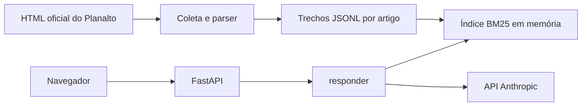

# PRD: Assistente de Documentos (`assistente-documentos`)

**Status:** rascunho revisado para aprovação do Lucas
**Autor do projeto:** Lucas (projeto individual)
**Tema:** leis brasileiras do consumidor
**Repositório:** próprio e público (a criar)

## 1. Contexto

### Problema
Quem tem um problema de consumo pensa em linguagem comum ("comprei pela internet e me arrependi"), mas a lei usa outra linguagem ("direito de arrependimento", "vício do produto", "fornecedor"). Achar o artigo certo em uma norma longa, conferir se ele ainda vale e entender o que ele diz toma tempo. As respostas encontradas na internet nem sempre mostram a fonte. Esse problema é uma hipótese do autor e não foi validado com usuários externos.

### Autor
Lucas cursa o 1º período de uma graduação EAD e estuda sozinho. Não tem experiência profissional em desenvolvimento e está em transição depois de 8 anos em vendas e atendimento, com inglês C1. Já fez um site com painel em JavaScript e Supabase e projetos de estudo em Python/Django. O objetivo final é uma vaga de engenheiro de IA. O primeiro passo realista é estágio ou júnior em desenvolvimento, dados ou automação com IA.

### Tese do projeto
"Chat com documento" não diferencia ninguém. O projeto é individual, então **o diferencial de uso por pessoas reais foi perdido**, e o PRD assume isso abertamente. O diferencial passa a ser:
- avaliação rigorosa, reproduzível e publicada, inclusive quando o resultado é ruim;
- autoria verificável: Lucas escreveu o núcleo e consegue explicá-lo;
- engenharia adequada ao domínio: trechos pela estrutura da lei, citação no nível do dispositivo e tratamento de texto revogado.

## 2. Objetivo

### Objetivos
- **O1.** Responder perguntas sobre as normas escolhidas, sempre citando norma e artigo, com parágrafo e inciso quando houver.
- **O2.** Admitir quando a resposta não está nas normas.
- **O3.** Não concluir casos pessoais nem recomendar ações.
- **O4.** Medir a qualidade com 60 perguntas em linguagem de consumidor e publicar as métricas de cada versão.
- **O5.** Medir o valor comparando o tempo de achar a resposta manualmente e com o assistente.
- **O6.** Manter o custo baixo e previsível, com limites aplicados pelo sistema.
- **O7.** Dar a Lucas domínio real de RAG e de avaliação, escrevendo essas partes à mão.
- **O8.** Mostrar o projeto a um recrutador sem exigir instalação, por demo pública ou vídeo (Q1), com um README claro.

### Não objetivos
- Dar orientação jurídica ou substituir advogado, Procon ou Defensoria.
- Conseguir usuários externos ou validar demanda de mercado.
- Cobrir jurisprudência, normas setoriais ou leis estaduais e municipais.
- Virar um produto genérico para qualquer lei ou documento.
- Maximizar sofisticação técnica. Cada complexidade precisa de uma métrica que a justifique.

## 3. Escopo da v1

Entra:
- Três normas federais, na redação compilada (seção 3.1).
- Trechos gerados pela estrutura de artigos, a partir do HTML oficial.
- Uma pergunta por vez, em português, sem histórico de conversa.
- Busca lexical BM25, resposta com Claude Haiku, citações por dispositivo, recusa e tratamento de caso pessoal.
- Avaliação com 60 perguntas congeladas e relatório por versão.
- Medição de tempo manual contra assistente.
- Duas páginas web, sem banco de dados e sem gravar o texto das perguntas.
- Demo pública com limites de custo, **pendente de confirmação do Lucas (Q1)**, com vídeo no README como alternativa.
- Um experimento de melhoria medido (M7).

### 3.1 Conjunto de normas proposto (padrão)

**Todas as informações abaixo devem ser conferidas na fonte oficial (Planalto) no M1**: número, ementa, vigência, redação atual e URL. Nada aqui foi verificado para este PRD.

| Norma | Por que entra | Sigla nas citações |
| --- | --- | --- |
| Lei 8.078/1990 (Código de Defesa do Consumidor) | É a norma central: direitos básicos, garantia, oferta, práticas e cláusulas abusivas. Concentra a maior parte das dúvidas | CDC |
| Decreto 7.962/2013 (comércio eletrônico) | Compras pela internet são um caso muito comum, e o decreto detalha informações, atendimento e arrependimento nesse contexto | Dec. 7.962 |
| Decreto 13.135/2026 (SAC) | Cobre reclamações sobre atendimento e cancelamento. Substituiu o Decreto 11.034/2022, revogado pelo seu art. 24. Conferir a quais fornecedores ele se aplica e a data exata de vigência no DOU | Dec. 13.135 |

**Reservas, fora da v1 e a conferir antes de qualquer uso:**
- Lei 10.962/2004 (afixação de preços): dúvida prática comum, mas é um tema estreito.
- Lei 12.291/2010 (exemplar do CDC nos estabelecimentos): muito curta, entra só se as perguntas mostrarem necessidade.
- Decreto 2.181/1997 (sanções e sistema de defesa do consumidor): mais voltado à fiscalização do que às dúvidas do consumidor.

Leis que apenas alteram o CDC, como a Lei 14.181/2021 (superendividamento), não entram como documento separado. Em princípio, seu conteúdo já aparece na redação compilada do CDC, o que deve ser conferido no M1.

## 4. Usuários

| Usuário | Precisa de | Observação |
| --- | --- | --- |
| Lucas (usuário e operador) | Achar a regra rápido, com fonte conferível; atualizar normas; acompanhar métricas e custo | Único usuário real e único operador |
| Recrutador ou avaliador técnico (visitante) | Entender o projeto em minutos e ver o sistema funcionando | Lê o README; usa a demo ou assiste ao vídeo |

Não há usuários externos previstos. Consumidores são a persona que orienta a linguagem das perguntas, mas não participam do projeto.

## 5. Requisitos funcionais

Cada entrega tem um único responsável.

| ID | Requisito | Resp. | Marco |
| --- | --- | --- | --- |
| RF1 | Manifesto `normas.yaml` com título, sigla, URL oficial, data de coleta, SHA-256 e última alteração observada | dev | M1 |
| RF2 | Coleta do HTML oficial, com cópia bruta versionada para reprodução sem depender do site. O Planalto recusa conexões por script nesta rede: o download é manual, pelo navegador, e `ingestao/coletar.py` só valida e registra os arquivos salvos | dev | M1 |
| RF3 | Parser que extrai hierarquia, artigos, parágrafos, incisos e alíneas, e que remove o texto tachado (`strike`) e os dispositivos revogados ou vetados, listando-os em relatório | dev | M1 |
| RF4 | Trechos por estrutura: um artigo por trecho. Artigo acima de cerca de 1.500 caracteres é dividido entre parágrafos ou incisos, repetindo norma, artigo e caput em cada parte. Cada trecho traz norma, artigo, lista de dispositivos, hierarquia, vigência e data de coleta | dev | M1 |
| RF5 | Verificador de atualização: recebe por argumento um HTML novo, salvo manualmente (sem acesso à rede), compara dispositivos com a versão coletada e relata as diferenças | dev | M1 |
| RF6 | Conjunto de 60 perguntas de referência (seção 13) | Lucas | M1 |
| RF7 | `buscar(pergunta, k)` com BM25 sobre os trechos, com tokenização em português | Lucas | M2 |
| RF8 | Avaliação da busca: Hit@5 e MRR por artigo e por dispositivo, por tipo de pergunta, sem usar a API | Lucas | M2 |
| RF9 | `montar_prompt` e geração com Claude, usando apenas os trechos numerados | Lucas | M3 |
| RF10 | Extração de citações, mapeando para norma, artigo, parágrafo e inciso, e descartando as que não existem nos trechos | Lucas | M3 |
| RF11 | Recusa em três pontos: limiar de busca antes da API, sinal `SEM_RESPOSTA` do modelo e ausência de citação válida | Lucas | M3 |
| RF12 | Tratamento de caso pessoal ou pedido de recomendação (seção 7) | Lucas | M3 |
| RF13 | `responder(pergunta)` unindo busca, geração, citações, recusa e caso pessoal, com uso pela linha de comando | Lucas | M3 |
| RF14 | Execução da avaliação completa, planilha de notas e cálculo das métricas | Lucas | M4 |
| RF15 | `comparar` entre duas versões e histórico `avaliacao/HISTORICO.md` | Lucas | M4 |
| RF16 | API FastAPI chamando `responder()`, sem alterar o núcleo | dev | M5 |
| RF17 | Interface web com pergunta, resposta, citações com o texto do dispositivo, link oficial, data de coleta e estados de espera, recusa e erro | dev | M5 |
| RF18 | Limites de tamanho e frequência, contadores em memória e modo de manutenção | dev | M5 |
| RF19 | Avisos: não é orientação jurídica, não substitui advogado ou Procon, projeto independente sem vínculo com órgão público, pergunta enviada à Anthropic | dev | M5 |
| RF20 | Registro mínimo: somente status, tokens, latência e custo, sem o texto da pergunta | dev | M5 |
| RF21 | Deploy público ou alternativa de vídeo, conforme Q1, e CI | dev | M0 e M6 |
| RF22 | README: estrutura, instalação, arquitetura e reprodução das métricas | dev | M6 |
| RF23 | README: decisões, erros analisados e aprendizados, com texto próprio | Lucas | M6 e M7 |
| RF24 | Roteiro e gravação do vídeo, se Q1 escolher vídeo ou como material complementar | Lucas | M6 |
| RF25 | Experimento de melhoria escolhido a partir dos erros medidos | Lucas | M7 |
| RF26 | Medição de tempo manual contra assistente (seção 13.6) | Lucas | M7 |
| RF27 | Artigos que alteram outra norma e trazem texto dela: lista explícita `artigos_alteradores` por norma em `normas.yaml` (na v1, `cdc.art110` a `cdc.art117` e `dec7962.art8`). Esses artigos não entram em `dados/trechos.jsonl` nem geram identificadores de dispositivo. Vão para `dados/trechos_alteradores.jsonl`, com texto literal, `cita_outra_norma: true` e `norma_citada`, preenchida só se o nome constar do próprio texto (senão `null`). Nenhuma aspa é acrescentada. O relatório de ingestão lista esses artigos e alerta sobre artigo fora da lista com marcador interno de artigo, parágrafo ou numeração fora de sequência. O verificador de atualização continua comparando esses artigos | dev | M1 |

Textos fixos:
- **Recusa:** "Não encontrei essa informação nas normas disponíveis."
- **Aviso em toda resposta:** "Informação geral sobre a lei. Não é orientação jurídica e não substitui advogado ou Procon."
- **Nota de caso pessoal:** "Não posso avaliar o seu caso nem dizer o que você deve fazer. Para isso, procure o Procon, a Defensoria Pública ou um advogado."

### Formato de citação
O modelo recebe trechos numerados e cita no formato `[n]` ou `[n|detalhe]`, por exemplo `[2|§ 1º]`, `[2|parágrafo único]`, `[2|inciso IV]` ou `[2|§ 1º, inciso IV]`. O código valida e exibe no formato legal, por exemplo "CDC, art. 18, § 1º, inciso II". A alínea é mostrada dentro do texto do inciso, sem citação própria na v1.

Cada dispositivo tem um identificador canônico gerado na ingestão, por exemplo `cdc.art54-a.par2.inc3`. Artigos com letra, parágrafo único e números ordinais são casos de teste obrigatórios.

## 6. Requisitos não funcionais

**Desempenho**
- p95 de até 8 s por resposta, sem contar a partida a frio da hospedagem (meta inicial).

**Custo**
- Até US$ 0,0005 por pergunta.
- `max_tokens` de 400 e 5 trechos por pergunta.
- Limites da seção 14.

**Segurança**
- Chaves somente em `.env` local e em variáveis do ambiente de hospedagem.
- `.gitignore` e `.env.example` existem antes do primeiro commit.
- gitleaks no CI e GitHub push protection ligado.
- Chave separada para a demo, com limite próprio de gasto.
- Conteúdo do modelo inserido no HTML somente como texto, nunca com `innerHTML`.
- Pergunta de até 500 caracteres.
- Sem ferramentas para o modelo. A pergunta e os trechos são tratados como dados.

**Privacidade**
- Sem login, banco de dados ou identificador de usuário.
- O texto da pergunta não é gravado nem enviado aos logs. Passa apenas pela memória e pela API da Anthropic.
- O IP é usado somente em contador em memória para limitar a frequência.

**Compatibilidade**
- Python 3.12, navegadores atuais, layout usável em celular.

**Qualidade**
- `pytest`, `ruff check` e `ruff format --check` no CI; `prettier --check` no front-end.
- Testes sem chave, com API simulada.

**Reprodutibilidade**
- Cada resultado guarda commit, modelo, versão do conjunto e versão das normas.
- Não enviar `temperature`: no Claude Haiku 5.5, valores fora do padrão retornam erro 400. Como a resposta pode variar entre execuções, cada resultado guarda o texto gerado.
- As métricas publicadas podem ser recalculadas a partir dos arquivos do repositório, sem chave de API.

## 7. Telas e fluxo

### `index.html` (assistente)
- Mostra o aviso de que é informação geral e de que a pergunta vai para a Anthropic, com o pedido para não escrever dados pessoais.
- Tem campo de pergunta, contador de caracteres e até 3 exemplos clicáveis.
- Mostra a mensagem de espera. Após 5 s sem resposta, avisa que o servidor pode estar acordando.
- Na resposta, mostra o texto com marcadores e, para cada citação, a norma, o dispositivo, o texto literal, o link oficial e "Texto coletado em DD/MM/AAAA".
- Mostra sempre o aviso fixo.
- Tem estados distintos para sem resposta, caso pessoal, limite atingido, manutenção e erro.
- Se a coleta tiver mais de 90 dias, mostra que o texto pode estar desatualizado.

### `sobre.html`
- Lista as normas, com data de coleta, link oficial e dispositivos revogados tratados.
- Explica limites do sistema, o que não é gravado e a falta de validação com usuários externos.
- Declara que o projeto é independente.
- Mostra as métricas da versão publicada e o link do repositório.

### Fluxo
1. O usuário envia a pergunta.
2. A API valida o tamanho e os limites.
3. O sistema busca os 5 trechos mais relevantes.
4. Se a pontuação ficar abaixo do limiar, recusa sem chamar a API da Anthropic.
5. Caso contrário, gera a resposta e valida as citações.
6. O sistema devolve a resposta e registra somente os dados mínimos (RF20).

### Caso pessoal e pedido de recomendação
Exemplos do tipo: "a loja está errada no meu caso?", "vou ganhar?", "devo processar?".

- O modelo sinaliza `CASO_PESSOAL` no início da saída, e o código remove o sinal e acrescenta a nota fixa.
- **Texto da nota fixa (2026-11-09):** "Não posso avaliar o seu caso nem dizer o que você deve fazer. Posso mostrar apenas o que as normas dizem em termos gerais." Ela não encaminha a órgãos nem profissionais, porque isso seria recomendação de ação.
- Se houver regra nos trechos, a resposta apresenta somente a regra geral, com citação.
- A resposta não conclui quem tem razão, não prevê resultado, não calcula prazo do caso concreto e não recomenda ação.
- **Alteração de 2026-11-09:** se o pedido for apenas uma recomendação e não houver regra diretamente aplicável ao que se pergunta, sai somente a nota fixa. Se não houver regra nos trechos, sai a recusa.
- No gabarito, a referência desses pedidos é apenas a nota fixa (q054, q058 e q059). Nos demais casos pessoais, a referência é a regra geral, sem conclusão, previsão ou recomendação.
- Casos pessoais têm `respondivel: false` e não entram em Hit@5, MRR, acurácia nem citação correta. São medidos pela "Conduta em caso pessoal" (13.3).

### Rotas
| Rota | Função |
| --- | --- |
| `GET /` e `GET /sobre` | Páginas estáticas |
| `POST /api/perguntar` | Devolve `status` (`respondida`, `sem_resposta`, `limite`), `caso_pessoal`, `texto` e `citacoes` |
| `GET /api/saude` | Verificação simples de funcionamento |

## 8. Critérios de aceite

**Fundação e ingestão**
- **CA1.** Em um clone limpo, sem chaves, `pytest`, `ruff check` e `ruff format --check` passam.
- **CA2.** O gitleaks passa em todo o histórico, e `git ls-files` não lista `.env`.
- **CA3.** Em 15 dispositivos sorteados, com ao menos 5 alterados por lei posterior, o texto do trecho confere com a página oficial.
- **CA4.** Rodar a ingestão duas vezes sobre o mesmo HTML gera arquivos com hash idêntico.
- **CA5.** Em HTML de teste com texto tachado, artigo revogado e artigo vetado, nada disso chega aos trechos, e todos aparecem no relatório.
- **CA6.** Os identificadores são únicos. Testes cobrem artigo com letra (por exemplo, 54-A), parágrafo único, ordinais e incisos. Nenhum trecho passa do limite, e toda parte de artigo dividido repete norma, artigo e caput.
- **CA7.** O verificador de atualização relata artigo alterado em HTML de teste e não relata mudança em execução sem alteração.
- **CA32.** Nenhum artigo de `artigos_alteradores` aparece em `dados/trechos.jsonl`, nem como trecho nem na lista de dispositivos, e todos aparecem em `dados/trechos_alteradores.jsonl` com os campos do RF27. Em HTML de teste, artigo fora da lista com linha citada de outra norma, mesmo sem aspas, gera alerta no relatório. Nenhuma referência de `perguntas_v1.jsonl` aponta para esses artigos. Limitação: citação sem aspas e em sequência perfeita não gera alerta, então cada novo HTML exige conferência manual da lista `artigos_alteradores`.

**Conjunto de perguntas**
- **CA8.** Pelo campo `tipo` escrito, o conjunto tem 25 diretas, 12 difíceis, 13 fora das normas e 10 casos pessoais, com origem pública registrada em cada pergunta. As divisões dev e teste seguem a contagem por desfecho da seção 13.2.
- **CA9.** O histórico do Git mostra as 60 perguntas em commit anterior ao commit das referências.
- **CA10.** A reconferência cega foi feita em ao menos 12 referências e 12 notas, com intervalo mínimo de 7 dias, e a concordância está publicada.

**Núcleo de RAG**
- **CA11.** `buscar` devolve no máximo `k` trechos, em ordem decrescente de pontuação, e o mesmo resultado em execuções repetidas.
- **CA12.** A avaliação da busca roda sem chave de API e grava Hit@5 e MRR por artigo e por dispositivo em JSON.
- **CA13.** Toda resposta com status `respondida` tem ao menos uma citação cujo dispositivo existe nos trechos recuperados.
- **CA14.** Com modelo simulado que cita `[9]` havendo 5 trechos, ou `[2|§ 7º]` quando o § 7º não existe, a citação é descartada e, sem outra válida, o status é `sem_resposta`.
- **CA15.** Com pontuação abaixo do limiar, o texto é a recusa fixa, sem citações e sem chamada à API.
- **CA16.** Com modelo simulado que devolve `CASO_PESSOAL`, o sinal não aparece ao usuário, e a nota fixa aparece.

**Avaliação**
- **CA17.** Cada arquivo de resultado contém commit, modelo, versão do conjunto, versão das normas, tokens, custo estimado e latência.
- **CA18.** `comparar` mostra as diferenças de métricas e lista as perguntas que melhoraram e pioraram.
- **CA19.** `HISTORICO.md` tem uma linha para cada tag publicada, e as métricas são recalculáveis sem chave de API.
- **CA20.** A medição de tempo seguiu a seção 13.6, com dados brutos publicados.

**Aplicação**
- **CA21.** Em celular, sem instalar nada e em janela anônima, é possível perguntar e ver a norma, o dispositivo, o texto literal, o link oficial e a data de coleta. Este critério só vale se Q1 confirmar a demo pública.
- **CA22.** Resposta simulada contendo `<script>` aparece como texto e não executa.
- **CA23.** Pergunta acima de 500 caracteres retorna HTTP 422. Limites excedidos retornam HTTP 429 sem chamar a API da Anthropic.
- **CA24.** Os logs de uma requisição de teste não contêm o texto da pergunta, e a aplicação não usa banco de dados.
- **CA25.** Os avisos aparecem na tela inicial, e o aviso jurídico aparece em toda resposta.

**Publicação e autoria**
- **CA26.** Antes de publicar a demo ou o vídeo, a divisão dev tem no máximo 1 erro grave em 20 perguntas com `respondivel: true`, 100% de citações válidas, nenhuma citação de dispositivo revogado e nenhuma conclusão ou recomendação em casos pessoais.
- **CA27.** A divisão de teste foi executada nas tags v0.3 e v1.0, e os resultados estão publicados mesmo que abaixo das metas.
- **CA28.** Nenhum commit que altera `rag/` ou `avaliacao/` tem o trailer `Autor-agente: dev`. Commits do dev sempre levam esse trailer. Exceção declarada: o commit de `avaliacao/perguntas_v1.jsonl` leva `Rascunho-por: Claude` e `Revisado-por: Lucas` (seção 13.1).
- **CA29.** O README contém tudo que a seção 15 lista como obrigatório, incluindo a frase de que não houve validação com usuários externos.
- **CA30.** Cada marco tem revisão do verificador, sem achado HIGH aberto.
- **CA31.** Se Q1 escolher vídeo, o README traz um vídeo de até 2 minutos com pergunta respondida, recusa e caso pessoal.

## 9. Arquitetura, arquivos e alternativas

### Arquitetura proposta



O índice é reconstruído na partida do servidor a partir dos trechos versionados. Não há banco de dados na v1.

### Por que o Supabase saiu
Ele servia para guardar perguntas, feedback, custo e o contador mensal. Sem colegas e sem gravar perguntas, sobra apenas o controle de custo, que passa a ter duas camadas:
- **Teto real:** chave da demo em um workspace da Anthropic com limite próprio de gasto. O recurso existe; falta confirmar se a conta do Lucas permite criá-lo (seção 14.4).
- **Proteção diária:** contadores em memória, que zeram quando o servidor reinicia. Isso é aceitável porque o teto real continua valendo.

Se esse limite por workspace não existir, a demo pública só sai com outro controle persistente, a decidir, ou a saída é o vídeo.

### Estrutura prevista

```text
assistente-documentos/
  README.md, versão no outro idioma (Q5)
  requirements.txt, .env.example, .gitignore, render.yaml
  .github/workflows/ci.yml                 dev
  normas.yaml                              dev
  dados/brutos/, dados/trechos.jsonl,
              dados/trechos_alteradores.jsonl      dev
  comum/tipos.py                           dev (Trecho, Citacao, Resposta)
  ingestao/   coletar.py, parser.py,
              trechos.py, verificar.py     dev
  rag/        busca.py, prompt.py,
              citacoes.py, responder.py    Lucas
  avaliacao/  perguntas_v1.jsonl, rodar.py,
              metricas.py, comparar.py,
              tempo_v1.csv, resultados/,
              HISTORICO.md                 Lucas
  app/        main.py, limites.py          dev
  web/        index.html, sobre.html,
              estilo.css, app.js           dev
  tests/      rag e avaliacao: Lucas; demais: dev
```

Contrato entre as partes, definido no M0:

```python
def buscar(pergunta: str, k: int = 5) -> list[Trecho]: ...
def responder(pergunta: str) -> Resposta: ...
```

### Dependências previstas
`anthropic`, `fastapi`, `uvicorn`, `rank-bm25`, `beautifulsoup4`, `lxml`, `httpx`, `python-dotenv`, `pyyaml`, `pytest`, `ruff`.

### Alternativas descartadas

| Alternativa | Motivo do descarte na v1 |
| --- | --- |
| PDF como fonte | HTML preserva melhor a estrutura e, em geral, marca o texto revogado. Em PDF, a citação depende de reconstruir artigos a partir de linhas |
| Trechos de tamanho fixo | Cortam artigos e dificultam a citação de parágrafo e inciso |
| Um trecho por inciso | Perde o caput, sem o qual o inciso muitas vezes não faz sentido |
| Citação por página | O texto legal é identificado por dispositivo, e a página do HTML não tem significado |
| LexML ou outra base estruturada | Pode facilitar o parser, mas não foi avaliada. Planalto é a fonte definida. Pode ser consultada no M1 se o HTML se mostrar difícil |
| LangChain ou LlamaIndex | Escondem justamente o que Lucas precisa aprender e explicar |
| Embeddings e banco vetorial desde o início | Sem medição não há como justificar. Até onde sei, a Anthropic não oferece embeddings próprios. Pode voltar no M7, pois a distância entre linguagem comum e linguagem legal é um motivo real |
| Sonnet como padrão | Cerca de 20 vezes o custo, sem evidência de ganho. Pode ser testado com medição |
| Supabase ou outro banco | Sem dados a guardar na v1 |
| Gravar perguntas ou botão de feedback | Sem usuários externos, o ganho não justifica o risco e o código |
| Streamlit | Foge da stack definida |
| Django | Pesado para duas páginas e duas rotas de API |
| GitHub Pages mais API separada | Adiciona CORS e dois deploys sem benefício |
| Citations API da Anthropic | Citação por regex é mais didática. Candidata a experimento, se o modelo escolhido suportar |
| Avaliação automática por LLM (RAGAS e similares) | Soma custo e cria outro sistema que também precisaria ser avaliado |
| Reranking, reescrita de pergunta e histórico de conversa | Complexidade sem medição que a justifique |

## 10. Riscos e dependências

O risco principal é o primeiro da tabela.

| Risco | Prob. | Impacto | Mitigação |
| --- | --- | --- | --- |
| **Resposta errada sobre direitos** | Alta | Alto | Citação obrigatória com texto literal, aviso em toda resposta, métrica de erro grave, gate CA26, recusa quando falta base, modo de manutenção |
| **Resposta usada como conselho para caso pessoal** | Alta | Alto | Regra da seção 7, nota fixa, tipo próprio de pergunta na avaliação, tolerância zero no gate |
| **Resposta correta, mas incompleta, porque há regra setorial, estadual, municipal ou jurisprudência fora do corpus** (por exemplo, planos de saúde, transporte aéreo, bancos) | Alta | Alto | Declarar o limite em `sobre.html` e no README, incluir esses temas nas perguntas fora das normas, buscar recusa ou aviso de alcance |
| **Lei alterada depois da coleta** | Média | Alto | Data de coleta visível, verificador antes de cada tag e uma vez por mês enquanto a demo estiver no ar, aviso após 90 dias, reexecução da avaliação quando a norma mudar. Atenção a alterações publicadas, mas ainda sem vigência |
| **Artigo revogado ou redação antiga tratados como vigentes** | Média | Alto | Remover `strike` e revogados no parser, testes com HTML de exemplo, CA3 focado em dispositivos alterados, métrica de citação de revogado |
| **HTML irregular do Planalto quebrar o parser** | Alta | Médio | Inspecionar no M1, cópia bruta versionada, relatório de contagem por norma, conferência manual (CA3), ajuste pontual no HTML do parser sem editar o texto legal |
| **Linguagem de consumidor não casar com BM25** | Alta | Médio | Fica medido no M2 por tipo de pergunta, e é candidato natural ao M7 |
| **Referências escritas por pessoa sem formação jurídica** | Alta | Médio | Referências ancoradas no texto literal, sem interpretação além da norma, reconferência cega. A limitação é publicada |
| **Viés de autor: Lucas escreve, referencia e dá notas** | Alta | Médio | Perguntas antes da norma, com prova no Git; notas sem ver a versão; reconferência cega; divisão de teste; limitação declarada |
| **Sem validação externa** | Certa | Médio | Assumido. Medição de tempo como substituta parcial, com o limite declarado. Não alegar demanda ou satisfação de usuários |
| **Abuso ou estouro de custo na demo** | Média | Médio | Chave separada com teto, contadores em memória, recusa antes da API. Sem teto confirmado, usar vídeo |
| **Injeção de prompt** | Média | Baixo | Sem ferramentas nem segredos no prompt, citações validadas por código, casos de teste adversariais |
| **Vazamento de chave** | Baixa | Alto | Gitleaks, push protection, chaves com limite de gasto. Em caso de vazamento: revogar antes de limpar o histórico |
| **Direitos sobre o texto** | Baixa | Baixo | Leis e decretos são atos oficiais, e a Lei 9.610/98, art. 8º, parece excluí-los da proteção autoral (conferir). Usar o texto oficial, sem conteúdo de sites comerciais de legislação nem respostas copiadas de terceiros |
| **Dados pessoais em fontes públicas de perguntas** | Baixa | Médio | Perguntas reescritas por Lucas, sem nomes, empresas identificáveis ou trechos copiados de reclamações |
| **Lucas sem tempo no semestre** | Média | Médio | Passos pequenos e independentes, sem datas fixas. O dev não avança sobre as partes do Lucas |
| **Hospedagem gratuita dorme ou muda de regras** | Média | Baixo | Mensagem de espera, vídeo ou GIF no README, sem pings artificiais. Plataforma trocável |

**Dependências:** páginas oficiais acessíveis, chave da Anthropic com crédito, contas no GitHub e, se Q1 confirmar a demo, no Render.

## 11. Fora de escopo

- Validação, entrevistas ou testes com outras pessoas.
- Jurisprudência, doutrina, súmulas e opiniões.
- Normas setoriais, estaduais e municipais.
- Análise de caso pessoal, cálculo de prazo concreto, geração de petição ou de reclamação.
- Histórico de versões antigas das leis.
- Upload de arquivos pelo usuário.
- Login, contas e histórico por usuário.
- Banco de dados, gravação do texto das perguntas e botão de feedback.
- Conversa com várias mensagens.
- Streaming de resposta.
- Painel administrativo.
- Busca web.
- Outros idiomas de pergunta.
- Aplicativo móvel e bot de WhatsApp.
- Embeddings, salvo se escolhidos no M7 com justificativa.

## 12. Marcos

As horas são estimativas minhas, a revisar no fim do M2. Lucas: **cerca de 45 a 60 h** no total. Ao fim de cada marco: demonstração, revisão do verificador e tag quando indicado.

**Regras para as partes do Lucas**
- Lucas pode pedir explicação e revisão, mas o código de `rag/` e `avaliacao/` é digitado por ele.
- O dev não edita essas pastas, e os commits dele levam o trailer `Autor-agente: dev`.
- O verificador revisa e aponta problemas. Achado HIGH nessas pastas volta para o Lucas, não para o dev.
- Cada passo termina com um teste ou resultado visível e cabe em uma sessão curta.

### M0. Fundação (dev)
- **dev:** repositório, `.gitignore`, `.env.example`, CI, gitleaks, `comum/tipos.py` e contrato.
- **Lucas:** instala o ambiente seguindo o README.
- **Demonstrável:** CI verde em um clone limpo.

### M1. Normas e perguntas (dev e Lucas, 10 a 15 h)
**Antes de ver as normas, Lucas faz L1.1 e L1.2**, pois essa ordem é parte do rigor da avaliação.
- L1.1 Escolher fontes públicas de dúvidas e escrever as 60 perguntas em linguagem de consumidor. Alterado em 2026-11-09: a pedido do Lucas, o Claude rascunhou as perguntas e Lucas as revisou (seção 13.1).
- L1.2 Fazer commit das perguntas sem referências.
- **dev:** RF1 a RF5 e RF27, com a conferência das normas no Planalto.
- L1.3 Conferir os dispositivos sorteados (CA3).
- L1.4 Escrever referências, com norma, dispositivo e trecho literal.
- L1.5 Fazer a divisão dev e teste e congelar a versão.
- L1.6 Reconferir às cegas 12 referências, 7 dias depois.
- **Demonstrável:** lei vira trechos com dispositivos, sem texto revogado, e `perguntas_v1.jsonl` fica congelado.
- **Métricas:** artigos processados, dispositivos removidos, concordância da reconferência.

### M2. Busca, tag v0.1 (Lucas, 6 a 8 h)
- L2.1 Carregar os trechos do JSONL e imprimir um deles.
- L2.2 Escrever `tokenizar` (minúsculas e remoção de pontuação), com testes.
- L2.3 Criar o índice com `rank-bm25` e escrever `buscar`.
- L2.4 Testar com 3 perguntas cujo artigo correto é conhecido.
- L2.5 Calcular Hit@5 e MRR por artigo na divisão dev e gravar o JSON.
- L2.6 Acrescentar o cálculo por dispositivo.
- L2.7 Ler 5 falhas e registrar a causa provável.
- **Demonstrável:** linha de comando que mostra trechos e dispositivos.
- **Métricas:** primeira linha de base de Hit@5 e MRR.

### M3. Resposta com citação legal, recusa e caso pessoal (Lucas, 10 a 14 h)
- L3.1 Fazer uma chamada simples à API e imprimir a resposta e os tokens.
- L3.2 Escrever `montar_prompt`, testado sem API.
- L3.3 Escrever `gerar`, com chave por variável de ambiente, `max_tokens`, `output_config.effort` e timeout, sem `temperature`. Testar `thinking` desligado com `effort` `low`, porque o raciocínio também consome `max_tokens`.
- L3.4 Extrair `[n]` com regex, com testes.
- L3.5 Extrair e validar o detalhe `[n|§ 1º]`, com testes.
- L3.6 Formatar a citação ("CDC, art. 18, § 1º").
- L3.7 Implementar a recusa pelo modelo e a recusa sem citação válida.
- L3.8 Escolher um limiar inicial da busca usando a divisão dev.
- L3.9 Implementar o sinal `CASO_PESSOAL` e a nota fixa.
- L3.10 Escrever `responder` e o uso pela linha de comando.
- **Demonstrável:** terminal com resposta citada, recusa e caso pessoal.

### M4. Avaliação completa, tag v0.2 (Lucas, 7 a 9 h)
- L4.1 Escrever `rodar.py`, que grava resposta, citações, tokens, custo, latência e metadados.
- L4.2 Exportar um CSV para dar notas sem ver qual versão gerou a resposta.
- L4.3 Dar as notas conforme a rubrica da seção 13.3.
- L4.4 Escrever `metricas.py`.
- L4.5 Escrever `comparar.py`.
- L4.6 Criar `HISTORICO.md`.
- L4.7 Reconferir às cegas 12 notas, dias depois, e registrar a concordância.
- **Demonstrável:** relatório da v0.2 com todas as métricas da seção 13.
- **Métricas:** primeira linha de base completa, ainda na divisão dev.

### M5. Web local (dev, Lucas 1 h)
- **dev:** RF16 a RF20, usando `responder()` sem alterá-la.
- **Lucas:** testa no celular e valida os textos dos avisos.
- **Demonstrável:** fluxo completo no navegador, com limites funcionando.

### M6. Publicação, tag v0.3 (dev e Lucas, 2 a 3 h)
Requer resposta a Q1.
- **dev:** RF21 e RF22. Se a demo for confirmada, faz deploy, configura a chave da demo e verifica o ambiente publicado.
- L6.1 Revisar o gate CA26.
- L6.2 Rodar a divisão de teste uma vez.
- L6.3 Gravar o vídeo, ou GIF curto no caso da demo pública.
- L6.4 Escrever a primeira versão de RF23.
- **Demonstrável:** link público, ou vídeo no README.
- **Métricas:** primeira medição oficial no teste.

### M7. Melhoria e valor medidos, tag v1.0 (Lucas, 8 a 12 h, dev se o deploy mudar)
- L7.1 Agrupar erros da avaliação.
- L7.2 Escrever a hipótese e a métrica esperada antes de mudar o código.
- L7.3 Implementar uma única mudança.
- L7.4 Comparar na divisão dev e decidir se a mudança fica ou sai.
- L7.5 Rodar a divisão de teste e publicar o resultado.
- L7.6 Fazer a medição de tempo e publicar os dados.
- **Candidatos:** stemming em português, glossário de linguagem comum para termos legais, inclusão da hierarquia no índice, busca híbrida, troca do modelo, Citations API.
- **Demonstrável:** "mudei X porque vi Y, e o resultado foi Z".
- Um experimento que não melhora é um resultado válido e também é publicado.

## 13. Plano de avaliação

### 13.1 Montagem do conjunto
**Perguntas:**
- **Alteração de 2026-11-09:** a pedido do Lucas, as 60 perguntas foram rascunhadas pelo Claude a partir de títulos de reclamações públicas do Reclame Aqui, sem consultar as normas coletadas, e revisadas e aprovadas por Lucas. Limitações declaradas no README: o Claude conhece o CDC, o que pode aproximar os temas da lei; 11 perguntas não vêm de reclamação específica; `url_origem` aponta para a lista da empresa. As regras abaixo continuam valendo para revisões futuras.
- São 60 perguntas escritas por Lucas, tiradas de dúvidas em fontes públicas, como páginas de orientação de Procons e órgãos públicos e reclamações públicas de consumidores. As fontes exatas são escolhidas e registradas no M1.
- A fonte fornece apenas a dúvida. Lucas reescreve com as próprias palavras, sem copiar a resposta, sem nomes e sem empresas identificáveis.
- São escritas em linguagem de consumidor e **antes de consultar a norma**, com commit próprio. Esse commit é a prova da ordem (CA9).

**Referências:**
- **Alteração de 2026-11-09:** a pedido do Lucas, as referências foram rascunhadas pelo Claude. Um verificador independente as revisou em duas rodadas: na primeira, 0 erro grave, 3 erros e 23 ajustes; na segunda, 9 ajustes restantes. Todos foram corrigidos. Em seguida, Lucas revisa item a item. Cada referência registra a norma, o dispositivo, o trecho literal e uma resposta curta presa ao texto.
- O campo `tipo` fica congelado como foi escrito, pois faz parte da prova de ordem (CA9). O desfecho do gabarito fica em `respondivel`, e a divergência entre tipo e desfecho é explicada em `observacao_tipo`. Exemplo: q025, q027, q029, q032 e q033 foram escritas como diretas ou difíceis, mas o texto das normas não as responde.
- Cada pergunta só tem como referência o que o texto diz. Se a resposta depender de interpretação ou jurisprudência, ela é classificada como fora das normas. Pergunta cuja única base seja texto de artigo alterador é classificada como fora das normas.

**Reconferência sem segunda pessoa:**
- Ao menos 12 referências sorteadas são refeitas às cegas, com intervalo mínimo de 7 dias.
- Ao menos 12 notas sorteadas são refeitas da mesma forma.
- Publica-se a concordância e toda correção feita.
- A reconferência cega das 12 referências fica com Lucas.
- **Limitação declarada:** nenhum dos revisores tem formação jurídica, e a revisão independente foi feita por outro modelo, não por uma pessoa. A reconferência detecta inconsistência, mas não substitui revisão jurídica.

**Formato (JSONL):**
```json
{"id": "q001", "pergunta": "...", "tipo": "direta", "origem": "procon",
 "url_origem": "...", "respondivel": true, "resposta_referencia": "...",
 "fontes": [["cdc.art49", "dec7962.art5"]], "fontes_opcionais": [], "fontes_contexto": [],
 "observacao_tipo": null, "literal": "...", "divisao": "dev"}
```

Em `fontes`, cada lista interna é um grupo de alternativas: um item do grupo basta. Todos os grupos precisam ser atendidos. No exemplo fictício acima, qualquer um dos dois dispositivos serviria.

**Alteração de 2026-11-09:** `fontes_contexto` lista dispositivos que a resposta deve respeitar, mas que não entram em Hit@5, MRR nem citação correta. No gabarito, esse campo traz `dec13135.art1.parunico`, que limita o alcance do Dec. 13.135. `fontes_opcionais` lista dispositivos que complementam a resposta e cujo texto pode aparecer no literal, mas que não são exigidos: citar um deles não penaliza, e omitir também não. O campo `respondivel` guarda o desfecho do gabarito. O campo `observacao_tipo` explica quando o desfecho diverge do tipo escrito.

### 13.2 Composição

**Alteração de 2026-11-09.** A composição planejada, pelo `tipo` escrito e congelado, foi de 25 diretas, 12 difíceis, 13 fora das normas e 10 casos pessoais, com 37 respondíveis previstas. No gabarito, 5 diretas ou difíceis não são respondidas pelas normas: q025, q027, q029, q032 e q033. A composição efetiva, pelo desfecho, ficou assim:

| Desfecho | Total | Dev | Teste |
| --- | --- | --- | --- |
| Respondível (`respondivel: true`) | 32 | 20 | 12 |
| Fora das normas (`respondivel: false`, tipo diferente de `caso_pessoal`) | 18 | 14 | 4 |
| Caso pessoal (`tipo: caso_pessoal`, `respondivel: false`) | 10 | 6 | 4 |
| **Total** | **60** | **40** | **20** |

O sorteio dev e teste é estratificado pelo desfecho, com cotas fixas, e a semente será registrada no repositório. As métricas por tipo escrito continuam relatadas à parte.

### 13.3 Métricas e metas iniciais

As metas são hipóteses, a recalibrar uma única vez depois da linha de base da v0.2. As metas da v1.0 valem para a divisão de teste. O número medido é publicado mesmo se ficar abaixo da meta. **Alteração de 2026-11-09:** as métricas usam o desfecho. Hit@5, MRR, acurácia, erro grave e citação correta usam as perguntas com `respondivel: true`. `fontes_contexto` não entra em Hit@5, MRR nem citação correta.

| Métrica | Definição | Medição | Meta v1.0 |
| --- | --- | --- | --- |
| Hit@5 por artigo (principal) | Todos os grupos de `fontes` têm um artigo entre os 5 trechos | Automática | ≥ 0,80 |
| Hit@5 por dispositivo | Igual, exigindo o parágrafo ou inciso de referência | Automática | Sem meta na v0.2; acompanhar |
| MRR | Média de 1 / posição do primeiro trecho correto, por artigo | Automática | ≥ 0,55 |
| Acurácia da resposta | Respostas "certa" / respondíveis ("parcial" conta 0, e é relatada à parte) | Humana | ≥ 0,75 |
| Taxa de erro grave | Erros graves / respondíveis | Humana | ≤ 5% |
| Citação válida | Respondidas com todas as citações existentes nos trechos e vigentes | Automática | 100% |
| Citação de revogado | Citações a dispositivo revogado ou vetado | Automática | 0 |
| Citação correta por artigo | Respondidas em que as citações atendem aos grupos de `fontes`, ou em que Lucas registra que o artigo citado sustenta a resposta | Automática e humana | ≥ 0,85 |
| Citação correta por dispositivo | Igual, no nível do parágrafo ou inciso | Automática e humana | ≥ 0,70 |
| Recusa correta | Recusadas / perguntas com `respondivel: false` e tipo diferente de `caso_pessoal` | Automática | ≥ 0,80 |
| Falsa recusa | Recusadas / perguntas com `respondivel: true` | Automática | ≤ 10% |
| Conduta em caso pessoal | Respostas sem conclusão, previsão ou recomendação / casos pessoais | Humana | 100% |
| Latência | p50 e p95 | Automática | p95 ≤ 8 s |
| Custo | Custo médio por pergunta | Automática | ≤ US$ 0,0005 |
| Tempo até a resposta | Seção 13.6 | Manual | Mediana com assistente ≤ 50% da manual |

**Nota sobre o tamanho (2026-11-09):** no teste, com 12 respondíveis, 4 fora e 4 casos, as metas equivalem a contagens inteiras:
- Hit@5 ≥ 0,80 exige 10 de 12.
- Acurácia ≥ 0,75 exige 9 de 12.
- Falsa recusa ≤ 10% admite 1 de 12.
- Erro grave ≤ 5% admite 0 de 12.
- Recusa correta ≥ 0,80 exige 4 de 4, e cada pergunta vale 25 pontos.
- Conduta em caso pessoal exige 4 de 4.

Esses números são sinais fracos e devem ser publicados com a contagem bruta ao lado.

**Rubrica:**
- **Certa:** responde corretamente, sem informação falsa.
- **Parcial:** correta, mas omite algo necessário. Também conta como parcial a resposta que aplica regra do Dec. 13.135 sem ressalvar o alcance dado por `dec13135.art1.parunico` (alteração de 2026-11-09).
- **Errada:** incorreta ou sem sustentação na norma.
- **Erro grave:** resposta errada apresentada como fato sobre direito, prazo, valor ou obrigação, capaz de prejudicar quem confiar nela.

Em pergunta respondível, uma recusa conta como falsa recusa, e não como erro grave.

### 13.4 Regras de uso das divisões
- **Dev:** usada para explorar, ajustar o limiar e analisar erros.
- **Teste:** usada apenas nas tags v0.3 e v1.0, sem ajuste a partir dos erros individuais.
- Cada mudança de limiar, prompt ou modelo acontece somente com a divisão dev.
- A divisão segue a seção 13.2: teste com 12 respondíveis, 4 fora das normas e 4 casos pessoais; dev com 20, 14 e 6. Uma vez sorteada, a divisão não muda (alteração de 2026-11-09).

### 13.5 Comparação entre versões
- Só se comparam versões com a mesma versão de perguntas, normas e rubrica.
- Se o conjunto ou as normas mudarem, a versão anterior é reexecutada antes da comparação.
- `perguntas_v1.jsonl` não muda. Correções de erro de referência são registradas e reaplicadas às versões anteriores.
- Uma mudança só é declarada melhora se ganhar ao menos 3 perguntas líquidas na divisão dev e não criar erro grave novo. É uma regra prática, não um teste estatístico.
- A margem de erro é publicada: com 80% de acerto, a margem de 95% é cerca de ±18 pontos com 20 perguntas e ±23 pontos com 12.
- A busca roda sem custo. A geração é reexecutada apenas quando busca, prompt, limiar ou modelo mudam.

### 13.6 Valor: tempo manual contra assistente

Esta métrica substitui o uso real como evidência de valor, com alcance bem menor.

- Usa 12 perguntas novas, fora do conjunto, formuladas como no M1 e agrupadas em 6 pares de dificuldade parecida.
- Em cada par, uma pergunta é respondida manualmente e a outra com o assistente, por sorteio. Nenhuma pergunta é feita pelos dois métodos, para evitar efeito de memória.
- **Manual:** abrir a norma no Planalto e buscar com o localizador do navegador.
- **Assistente:** perguntar e conferir o dispositivo citado no texto oficial.
- O tempo vai do início até uma resposta escrita com o dispositivo, com limite de 5 minutos.
- São registrados o tempo e o acerto. Uma resposta rápida e errada não conta como ganho.
- Depois, a referência de cada pergunta é conferida na norma.
- Publicam-se a mediana e os dados brutos.

**Limitação declarada:** são poucas perguntas, feitas por uma só pessoa, que já conhece as normas e o sistema. O resultado não pode ser generalizado para outros usuários e não prova demanda.

## 14. Custos

### 14.1 Modelo escolhido
**Claude Haiku 5.5 (`claude-haiku-5-5`)**, conferido em 2026-11-05 como o Haiku mais barato disponível, com o ID em variável de configuração. A tarefa é ler poucos trechos e responder com base neles, o que não exige um modelo maior até que a avaliação prove o contrário. A troca só acontece com medição (candidata do M7) e dentro do orçamento.

### 14.2 Estimativa por pergunta
Preços conferidos em 2026-11-05: Haiku 5.5 a US$ 0,10 e US$ 0,50 por milhão de tokens de entrada e saída, em prompts de até 100 mil tokens; Sonnet 5.5 a US$ 2 e US$ 10.

Entrada: 5 trechos de cerca de 400 tokens, mais 350 de instruções e pergunta, somando 2.350 tokens. Saída máxima: 400 tokens.

| Modelo | Custo máximo calculado | Valor usado no orçamento |
| --- | --- | --- |
| Haiku 5.5 | US$ 0,000435 | US$ 0,0005 |
| Sonnet 5.5 | US$ 0,0087 | US$ 0,009 |

### 14.3 Orçamento mensal proposto

| Item | Volume | Haiku 5.5 | Sonnet 5.5 |
| --- | --- | --- | --- |
| Avaliação na divisão dev | 10 execuções de 40 perguntas | US$ 0,20 | US$ 3,60 |
| Testes do Lucas, demo e medição de tempo | 100 perguntas | US$ 0,05 | US$ 0,90 |
| **Total** | | **US$ 0,25** | **US$ 4,50** |

Hospedagem e GitHub: US$ 0 nos planos gratuitos, sem domínio próprio. Sem banco de dados. Uma execução completa de 60 perguntas custa cerca de US$ 0,03 com Haiku 5.5.

**Limites propostos (Q2):**
- Teto da conta Anthropic: US$ 5 por mês, configurado no console.
- Teto do workspace da demo: US$ 1 por mês, cerca de 2.000 perguntas. O limite vale por workspace, não por chave, e não pode ser aplicado no Default Workspace.
- Até 20 perguntas por dia no total e 10 por hora por IP, em memória.

### 14.4 Conferências

**Conferido em 2026-11-05:**
- Preço e ID do Claude Haiku 5.5 na documentação da Anthropic.
- Limite mensal de gasto por workspace no console. Não existe por chave nem no Default Workspace.
- Plano gratuito do Render: 750 horas por mês, suspensão após 15 minutos sem tráfego e partida a frio de cerca de 1 minuto. O disco é descartável.
- Lei 8.078/1990, Decreto 7.962/2013 e Decreto 13.135/2026 no site do Planalto. O Decreto 11.034/2022 consta como revogado.
- Conexão por script ao Planalto (`httpx`, `curl`): recusada nesta rede em 2026-11-05. As três páginas foram salvas pelo navegador (RF2 e RF5).

**Ainda a conferir:**
- Antes do M3: crédito mínimo, termos de uso e retenção de dados da API da Anthropic, e se a conta do Lucas permite criar o workspace com limite.
- No M1, feito em 2026-11-05 e registrado em `docs/conferencia-normas.md`: escopo de aplicação, formato do HTML, uso de `strike` e âncoras por artigo, e a MP de 2026 no art. 57 do CDC. Seguem abertas a data exata de vigência do Decreto 13.135/2026 no DOU e a situação atual dessa MP.
- No M7, se for usada: suporte da Citations API ao modelo.
- Aplicação da Lei 9.610/98 ao texto das normas. Este PRD não é parecer jurídico.

## 15. Publicação e o que mostrar ao recrutador

### Publicação
- Repositório público, com licença MIT proposta para o código.
- Tags v0.1, v0.2, v0.3 e v1.0, cada uma com release curta mostrando o que mudou e as métricas.
- **Demo pública (pendente de Q1):** front-end e API no mesmo serviço, no Render, com chave própria, teto de gasto e limites.
- **Alternativa em vídeo:** vídeo de até 2 minutos no README, mostrando pergunta respondida com citação, recusa e caso pessoal, além de instruções para rodar localmente. Custa menos e não tem risco de abuso nem de demo fora do ar, mas o recrutador não testa com perguntas próprias, e isso muda a decisão original de demo sem instalação.

### Obrigatório no README
1. Em poucas linhas: o que é, para que serve e o link da demo ou do vídeo.
2. Aviso: não é orientação jurídica nem substitui advogado ou Procon.
3. Frase clara: **"Este projeto não foi validado com usuários externos."**
4. GIF ou vídeo curto.
5. Tabela de métricas por versão, com tamanho do conjunto e margem de erro.
6. Como as perguntas foram feitas, incluindo a prova no Git, a reconferência cega e as limitações por haver um único autor sem formação jurídica.
7. Medição de tempo, com dados brutos e limitações.
8. Arquitetura em diagrama, com a estratégia de trechos por artigo.
9. Decisões e alternativas descartadas, com o motivo de cada uma.
10. Exemplos de erros reais e o que foi feito sobre eles, incluindo experimentos sem ganho.
11. Custo real por pergunta e limites.
12. Normas usadas, data de coleta e limitações de alcance.
13. Autoria: o que Lucas escreveu, o que foi feito com agentes de IA, como tudo foi revisado e como verificar pelo trailer.
14. Aprendizados, na voz do Lucas.
15. Como rodar localmente e como recalcular as métricas.

### Para recrutador e entrevista
Sem usuários externos, a prova do projeto é outra, e ela precisa ser muito sólida:

- **Avaliação como peça principal.** O número mais forte é a avaliação honesta, e não uma nota alta. A ordem das perguntas provada no Git, a divisão de teste, as margens de erro e as falhas analisadas mostram maturidade.
- **Autoria verificável.** Qualquer pessoa pode conferir no histórico quais pastas foram escritas por Lucas. A separação entre núcleo manual e restante feito por agentes deve ser dita com clareza, o que também demonstra uso responsável de IA.
- **Engenharia de domínio.** Vale destacar a citação no nível do dispositivo, o tratamento de texto revogado e a distância entre linguagem comum e legal medida nas métricas.
- **Limites honestos.** Declarar a falta de usuários e não alegar impacto é melhor do que inflar o resultado.
- **Conexão com a trajetória.** Os 8 anos em vendas e atendimento dão contato direto com o lado prático das relações de consumo. Isso pode ser dito como motivação, sem sugerir conhecimento jurídico.

Lucas deve conseguir explicar, sem consulta: como o BM25 funciona, por que trechos por artigo, como a citação é validada, como a recusa funciona, o que Hit@5 mede, por que existe a divisão de teste, o que a reconferência cega detecta e não detecta, e por que a v1 não usa embeddings.

O README em inglês aproveita o C1 e amplia o público.

## 16. Perguntas abertas para o Lucas

**Bloqueiam uma etapa (nenhuma bloqueia o início do M0):**
- **Q1. Bloqueia o M6.** Demo pública com limites de custo ou vídeo no README? A proposta é demo pública, se o limite de gasto por chave ou workspace existir.
- **Q2. Bloqueia o M3.** Você aprova o teto de US$ 5 por mês na conta e de US$ 1 por mês na demo? Qual o gasto máximo total do projeto?

**Não bloqueiam, pois têm padrão:**
- **Q3.** Aprova as três normas da seção 3.1? Padrão: seguir com elas, sujeitas à conferência no Planalto.
- **Q4.** Quantas horas por semana você tem? Padrão: marcos sem datas.
- **Q5.** README principal em português ou em inglês? Padrão: português, com versão completa em inglês. Isso depende de você mirar vagas no Brasil ou no exterior.
- **Q6.** Aprova a licença MIT e o nome do repositório? Padrão: MIT e `assistente-documentos`.
